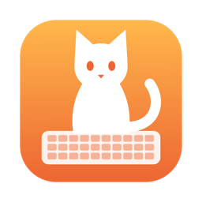

<p align="center"></p>

# 🐈 CatMode

**Your cat can sit on the keyboard. Your movie keeps playing.**

Cats love warm MacBook keyboards, especially when you are watching a movie or listening to music. One paw on the space bar and the movie pauses; a cat sitting down types gibberish into whatever is open, or hits the media keys and stops the music.

CatMode is a tiny menu-bar app that **locks only the keyboard**. The screen, the trackpad, the mouse and whatever is playing keep working exactly as before.

## Features

- 🔒 **Locks the keyboard, nothing else.** All keys, modifier keys and the media keys (play/pause, volume, brightness) are blocked. The trackpad and mouse keep working.
- 🐾 **Detects the cat.** When four or more keys are held down at once, which a person almost never does but a cat sitting down always does, CatMode locks the keyboard on its own. You can switch this off in the menu.
- ⎋ **Unlock with ESC ×4.** Press ESC four times within two seconds. A cat sitting on ESC doesn't count, because a held key only repeats; it takes four separate presses.
- 🖱️ **Or unlock with the mouse.** Click the menu-bar icon → *Unlock Keyboard*.
- 🔑 **Never locks you out.** When the Mac's screen locks, CatMode unlocks and lets every key through, so you can always type your password.
- 🪶 **Tiny.** One Swift file, no dependencies, no network access, no settings window. It never records or stores what you type.

The menu-bar icon shows ⌨️ a keyboard while unlocked and 🐈 a cat while locked.

## Install

1. Download `CatMode.zip` from the [latest release](../../releases/latest) and unzip it.
2. Move `CatMode.app` into your **Applications** folder.
3. Open it. The first time, macOS will block it (see below).

### "CatMode can't be opened": the app is not notarised

CatMode is free and open source, and it isn't signed with a paid Apple Developer account or notarised by Apple. macOS therefore refuses to open it the first time and says it "cannot verify that it is free of malware". You can read every line of the code in this repository; to open it anyway, do **one** of the following:

**Option A, System Settings (macOS 15 Sequoia and later):**
1. Open CatMode once and close the warning.
2. Open **System Settings → Privacy & Security**.
3. Scroll down to *"CatMode" was blocked…* and click **Open Anyway**, then confirm with your password or Touch ID.

**Option B, Finder (macOS 14 Sonoma and earlier):** right-click (or Control-click) `CatMode.app` → **Open** → **Open**.

**Option C, Terminal (any version):** remove the quarantine flag that macOS puts on downloaded files:

```bash
xattr -dr com.apple.quarantine /Applications/CatMode.app
```

You only need to do this once per downloaded version.

### Allow Accessibility access

To block keys, CatMode needs **Accessibility** permission. On first launch macOS asks for it:

1. Click **Open System Settings** in the prompt, or go to **System Settings → Privacy & Security → Accessibility**.
2. Switch **CatMode** on.
3. If the menu still says *Waiting for Accessibility permission…* after a few seconds, quit CatMode and open it again.

> **After an update**, macOS may treat the new version as a different app, because it isn't signed with a developer certificate. If locking stops working, open the Accessibility list, remove CatMode with **–**, and add it again with **+** (or simply switch it off and on).

## Usage

| What | How |
|------|-----|
| Lock the keyboard | Menu-bar icon → **Lock Keyboard**, or let the cat lock it |
| Unlock | Press **ESC four times** within 2 seconds, or menu-bar icon → **Unlock Keyboard** |
| Auto-lock when a cat is detected | Menu-bar icon → **Auto-lock when cat detected** (on by default) |
| Quit | Menu-bar icon → **Quit CatMode** |

If you use a menu bar manager such as Bartender or Ice, the icon may be in its hidden section.

## Good to know

- **The first keys of a cat's landing get through.** Auto-lock reacts when the fourth key goes down, so the first three keys still reach the app, and a space may already have paused the movie. For a cat-proof movie night, lock manually before you start.
- **Unlocking while the cat is still on the keyboard** locks it again immediately. That's on purpose.
- **Touch ID / the power button** can't be blocked by any app.
- **Apple Silicon and Intel** are both supported (macOS 13 Ventura or later).

## Build from source

You need Xcode or the Xcode Command Line Tools (`xcode-select --install`).

```bash
make app       # build build/CatMode.app (universal, ad-hoc signed)
make run       # build and open it
make install   # build and copy it to /Applications
make test      # run the self-check for the lock logic
make icon      # redraw AppIcon.icns from icon.swift
```

Always start the app with `open` / Finder rather than running the binary in a terminal, otherwise macOS asks for the Accessibility permission on behalf of your terminal.

Each rebuild gets a new ad-hoc signature, so you may have to allow Accessibility again. To avoid that, sign with your own certificate: `make app SIGN="Developer ID Application: Your Name"`.

### Releases

Pushing a tag builds a universal app and publishes it as a GitHub release (see `.github/workflows/release.yml`):

```bash
git tag v1.0.0
git push origin v1.0.0
```

## How it works

CatMode installs a macOS [event tap](https://developer.apple.com/documentation/coregraphics/cgevent/tapcreate(tap:place:options:eventsofinterest:callback:userinfo:)) that sees keyboard events before any app does. While locked it drops key, modifier and media-key events and lets everything else through. The whole app is [`main.swift`](main.swift).

## License

[MIT](LICENSE)
